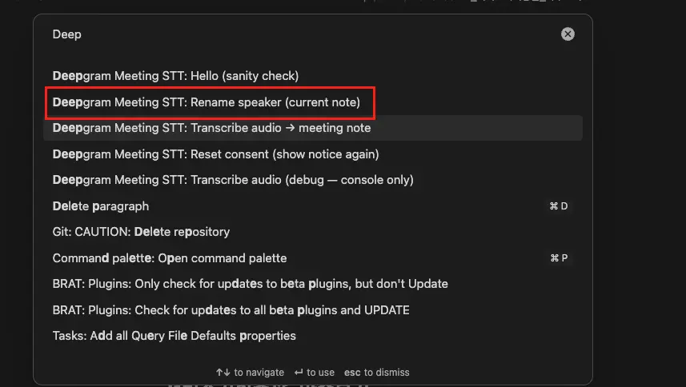

# Features & Guides

`README.md`에는 설치·기본 사용법이 들어있고, 이 문서는 **실제로 plugin을 잘 쓰기 위한 가이드·팁**을 모읍니다. 새 기능이 추가되면 이 파일에 섹션을 보탭니다.

## 목차

- [정확도 가이드 (오디오 품질·화자 수)](#정확도-가이드)
- [화자 이름 정리 (Rename speaker)](#화자-이름-정리)
- [템플릿 토큰](#템플릿-토큰)
- [AI 요약 (Gemini)](#ai-요약-gemini)
- [그래프뷰 클러스터링](#그래프뷰-클러스터링)
- [업데이트 확인](#업데이트-확인)
- [모바일에서 사용](#모바일에서-사용)

---

## 정확도 가이드

STT 정확도는 **녹음 환경의 영향을 크게 받습니다**. 좋은 회의록을 위해 입력 단계에서 신경 써주세요.

### 오디오 품질

- **권장 sample rate**: 16 kHz 이상 (Deepgram은 8/16/24/32/48 kHz 지원)
- **권장 포맷**: 품질 우선이면 `FLAC` / `WAV` (Linear PCM), 파일 크기 우선이면 `MP3` / `AAC` / `Opus`
- 새 녹음 환경 도입 시 짧은 샘플(5~10분)로 인식률을 먼저 테스트하는 것을 Deepgram이 권장합니다.

### 화자 수

- Deepgram diarize는 **명시적 화자 수 상한 없음** — 공식적으로 16명 이상에서도 검증됨 ([출처](https://deepgram.com/learn/what-is-speaker-diarization))
- 화자가 늘수록 오인식(speaker confusion) 가능성 ↑ — 4명·CER 10% 기준 1시간 회의에서 약 6분 분량의 발언이 잘못된 화자로 매핑될 수 있음
- **권장**: 정확도가 중요한 회의는 **8명 이하** + 발언이 어느 정도 연속되는 환경
- 격렬한 turn-taking은 화자 분리 실패율이 높음

### 회의실 녹음 체크리스트

| 항목 | 권장 |
|---|---|
| 마이크 종류 | 화자 가까이(~30cm) 또는 천장 array 마이크 |
| 화자 ↔ 마이크 거리 | 가까울수록 ↑ |
| 백색 노이즈 | 에어컨·키보드·프로젝터 fan 등 최소화 |
| 에코 / 반향 | 유리·벽 반사 많은 공간 ↓ |
| 동시 발화 | 두 명 이상 동시 발언 시 분리 실패 가능 |
| 사전 테스트 | 새 회의실 / 녹음기 도입 시 짧은 샘플로 검토 |

> 결과가 만족스럽지 않으면 [Deepgram Playground](https://playground.deepgram.com)에서 다른 모델과 비교해볼 수 있습니다.

---

## 화자 이름 정리

회의록의 frontmatter `speakers` 항목은 기본적으로 `화자 1`, `화자 2` 같은 익명 라벨로 채워집니다. 실제 이름으로 바꿔두면 검색·추적이 쉬워집니다.

1. 정리할 회의록 노트 열기.
2. 명령 팔레트(`Cmd+P` / `Ctrl+P`) → **"화자 이름 변경 (현재 노트)"** 실행.



3. 모달이 열리면 상단에 **현재 노트 이름**이 표시되고, **"변경 전" 칸은 드롭다운**으로 노트에서 자동 감지된 화자 목록이 채워집니다.
   - **변경 전**: 드롭다운에서 변경할 화자 선택 (예: `화자 1`)
   - **변경 후**: 실제 이름 입력 (예: `홍길동`)
4. **치환** 클릭 → 본문의 모든 `화자 1`과 frontmatter `speakers` 배열의 라벨이 일괄 치환됩니다.

> 화자가 여러 명이면 명령을 여러 번 실행하시면 됩니다.

---

## 템플릿 토큰

설정 → 변환 옵션 → **"템플릿 경로"** 에 vault 내 마크다운 파일을 지정하면, 그 안의 다음 토큰들이 자동 치환됩니다.

| 토큰 | 치환 결과 |
|---|---|
| `{{date}}` | `YYYY-MM-DD` (변환 실행 시각 기준) |
| `{{title}}` | 사용자 입력 제목 |
| `{{transcript}}` | diarize on이면 화자별 마크다운, off면 plain text |
| `{{speakers_transcript}}` | 항상 화자별 마크다운 (시간 세그먼트 포함) |
| `{{plain_transcript}}` | 항상 plain text |
| `{{speakers_list}}` | 등장 화자 목록을 YAML 배열로 (예: `["화자 1", "화자 2"]`) |
| `{{duration}}` | `5m 30s` 같은 형식 |
| `{{audio_link}}` | `[[VoxNote/Audio/녹음.m4a]]` wikilink |
| `{{language}}` | `ko` / `en` / `auto` |
| `{{model}}` | `nova-3` / `nova-2` |

내장 기본 템플릿 (사용자가 별도 경로 지정 안 했을 때):

```markdown
---
date: {{date}}
type: meeting
tags: [voxnote/transcript]
duration: {{duration}}
language: {{language}}
source: {{audio_link}}
speakers: {{speakers_list}}
---

# {{title}}

{{transcript}}
```

> `voxnote/transcript` 계층 태그는 그래프뷰에서 모든 STT 노트가 단일 `#voxnote` 허브 아래로 묶이게 합니다. 본인 워크플로우에 맞춰 `meeting`·`stt` 등을 추가해도 군집화는 그대로 동작합니다.

---

## AI 요약 (Gemini)

STT만 사용해도 충분하지만, Gemini API 키를 등록하면 원하는 양식으로 요약된 두 번째 노트를 동시에 생성할 수 있습니다.

### 설정

1. [Google AI Studio](https://aistudio.google.com/apikey)에서 API 키 발급
2. 설정 → VoxNote → **"Gemini API 키"**에 붙여넣기
3. 모델은 기본 `gemini-2.5-flash` (빠르고 저렴). 더 높은 품질이 필요하면 `gemini-2.5-pro`로 전환.

키가 비어있으면 AI 관련 메뉴는 보이지 않고 기존 STT 흐름만 동작합니다.

### 동작 방식

- **템플릿 폴더** (`VoxNote/Templates/`, 변경 가능): 요약 양식을 정의하는 마크다운 파일들. 처음 설치 시 `Meeting.md`(favorite), `Interview.md`, `Lecture.md` 3개가 자동 생성됩니다.
- **요약 폴더** (`VoxNote/AI-Summaries/`): 요약 결과 노트가 `{제목} (요약).md` 이름으로 저장됩니다. frontmatter에 원본 STT 노트로의 `source: "[[...]]"` 백링크가 자동 삽입됩니다.

### 우클릭 메뉴

오디오 파일 우클릭 → **VoxNote ▸**
- **STT만 추출** — 기존 흐름
- **⭐ STT + 요약: Meeting** — favorite 템플릿은 평면으로 노출
- **AI 요약 ▸** — 그 외 템플릿들은 서브메뉴

기존 마크다운 노트 우클릭 → **VoxNote ▸ AI 요약: {template}** — STT 노트(또는 임의의 노트)를 새 템플릿으로 다시 요약할 수 있습니다.

### 템플릿 파일 형식

```markdown
---
name: "Meeting"
favorite: true
prompt: |
  Summarize the transcript as meeting minutes.
  - decisions: clear, one bullet per decision.
  - action_items: use checkbox markdown; include owner name when present.
placeholders:
  summary: "3-5 bullet overview of the discussion"
  decisions: "Bullet list of decisions made"
  action_items: "Checkbox list of action items (with owner if mentioned)"
---
# {{title}}

> Source: {{source}} · {{date}} · {{duration}}

## Summary
{{summary}}

## Decisions
{{decisions}}

## Action Items
{{action_items}}
```

- `prompt` — Gemini에게 보내는 지시문. 응답 언어는 UI 언어를 따라 자동으로 추가됩니다.
- `placeholders` — Gemini가 채울 키와 그 설명. Gemini 2.5의 structured output(JSON mode)으로 한 번에 채워집니다.
- `favorite: true` — 우클릭 메뉴 평면에 노출. 여러 개 가능.
- 본문에서 `{{key}}` 형태로 placeholder를 사용. 시스템 placeholder도 함께 쓸 수 있음.

### 시스템 placeholder (코드가 채움)

| 토큰 | 치환 결과 |
|---|---|
| `{{transcript}}` | STT 결과 본문 (요약 명령에서는 입력으로도 사용됨) |
| `{{title}}` | 사용자 입력 제목 |
| `{{date}}` | `YYYY-MM-DD` |
| `{{datetime}}` | `YYYY-MM-DD HH:MM` |
| `{{source}}` | 원본 STT 노트로의 `[[wikilink]]` |
| `{{language}}` | UI 언어 라벨 (예: `Korean`) |
| `{{duration}}` | `HH:MM:SS` 또는 `MM:SS` |
| `{{speakers}}` | 등장 화자 목록 (콤마 구분) |

### 새 템플릿 만들기

명령 팔레트 → **"새 요약 템플릿 만들기 (Create new summary template)"** 를 실행하면 모든 시스템 placeholder가 주석으로 정리된 스타터 파일이 `Templates/` 폴더에 생성되어 바로 열립니다.

### 실패 시 동작

- **STT 실패**: 전체 abort. 요약 단계 실행 안 함.
- **요약 실패**: STT 노트는 살리고 요약만 Notice로 에러 표시. Gemini가 잘못된 JSON을 반환하면 자동으로 1회 재시도합니다.

---

## 그래프뷰 클러스터링

옵시디언 그래프뷰에서 VoxNote 결과 노트들이 산발적으로 떠 보이지 않도록, 모든 생성물에 **계층 태그**가 자동으로 박힙니다.

| 노트 종류 | 태그 | 위치 |
|---|---|---|
| STT 회의록 | `voxnote/transcript` | `VoxNote/STT/...` |
| AI 요약 | `voxnote/summary` | `VoxNote/AI-Summaries/...` |
| 가이드 문서 (`VoxNote/README.md`·`FEATURES.md`) | `voxnote/docs` | `VoxNote/` 루트 |

옵시디언은 계층 태그의 부모(`voxnote`)를 자동으로 그래프 노드로 만들기 때문에:

```
       #voxnote (hub)
        ├── #voxnote/transcript ── STT 노트들
        ├── #voxnote/summary    ── AI 요약 노트들
        └── #voxnote/docs       ── README·FEATURES (가이드)
```

요약 → STT 백링크(`source` frontmatter + 본문 `> 출처: [[...]]`)가 같은 세션끼리 추가로 묶어주므로, 한 회의 단위가 두 노드의 짝으로 그래프에 떠오릅니다.

### 가이드 문서(README·FEATURES) 숨기는 법

자동 생성된 `VoxNote/README.md`·`VoxNote/FEATURES.md`는 정적 가이드 문서라 그래프에서 보일 필요가 없을 수 있습니다. 옵시디언 설정 → **그래프뷰 → Filters → Search** 에 다음 한 줄을 추가하세요:

```
-tag:#voxnote/docs
```

`voxnote/docs` 태그가 박힌 노드가 그래프에서 완전히 사라집니다. 첨부파일 토글이나 다른 필터는 그대로 유지됩니다.

### 그래프뷰 표시 팁

- **그래프뷰 우측 패널** → **필터 → 태그** 검색에 `voxnote`를 넣으면 VoxNote 결과만 따로 떠올라 깔끔하게 볼 수 있습니다.
- **첨부파일 보기**를 켜면 STT의 `source: [[...Audio/file.m4a]]` 링크가 살아나서 `Audio → STT → 요약` 3노드 사슬이 됩니다 (기본은 첨부파일이 숨겨져 있어 사슬이 끊어진 것처럼 보임).
- **로컬 그래프**에서 한 노트 기준으로 보면 같은 세션의 STT·요약·오디오만 표시됩니다.

### 기존 노트 일괄 적용

플러그인은 **새로 생성되는** 노트에만 태그를 박습니다. 이전에 생성한 노트는 그대로 두거나, 직접 frontmatter에 `tags: [voxnote/transcript]` (또는 `voxnote/summary`, `voxnote/docs`)를 추가하면 그래프 허브에 합류합니다. 특히 v2.0.1 이전에 동의 모달을 통과해서 받은 `VoxNote/README.md`·`VoxNote/FEATURES.md`는 frontmatter가 없으므로, `voxnote/docs` 태그로 숨기고 싶다면 두 파일 맨 위에 `---\ntags: [voxnote/docs]\n---` 블록을 직접 한 번 추가하시면 됩니다.

---

## 모바일에서 사용

이 플러그인은 옵시디언 **iOS / Android에서도 동작**합니다 (`isDesktopOnly: false`). 데스크톱 사용법과 거의 동일하되 몇 가지 차이가 있습니다.

| 데스크톱 | 모바일 대안 |
|---|---|
| Finder/Explorer에서 드래그앤드롭 | 다른 앱에서 **공유 → Obsidian** 또는 옵시디언 안에서 파일 import |
| 좌측 사이드바에서 우클릭 | 파일 아이콘을 **길게 누르기 (long-press)** → 컨텍스트 메뉴 |
| 명령 팔레트 `Cmd+P` | 좌측 사이드바 → ⋯ → "Command palette" |
| DevTools 콘솔 | 모바일은 콘솔 없음. 디버그 명령은 결과 확인 어렵습니다 — 정식 변환 명령 사용 권장 |

녹음 파일 사이즈가 큰 경우 모바일 메모리 한도와 셀룰러 데이터 사용량에 주의하세요. 1시간 회의 (~50MB)는 일반적으로 무리 없습니다.

---

## 업데이트 확인

설정 → "정보" 섹션에 두 가지 항목:

- **GitHub 릴리스**: 클릭하면 전체 release 목록 페이지가 새 탭으로 열립니다.
- **업데이트 확인**: GitHub Releases API로 최신 버전을 조회 → Notice로 결과 표시.
  - 새 버전 있음: `업데이트 가능: 0.5.1 (현재 0.5.0)` — 페이지를 자동으로 열지 않으니 "GitHub 릴리스" 버튼으로 가시면 됩니다.
  - 최신: `최신 버전입니다`
  - 로컬이 앞섬 (개발자 케이스): `로컬 버전이 릴리스보다 앞섭니다`

Community Plugins로 설치한 경우 옵시디언이 새 버전을 자동으로 안내하므로 이 버튼은 보조 진입점입니다.
